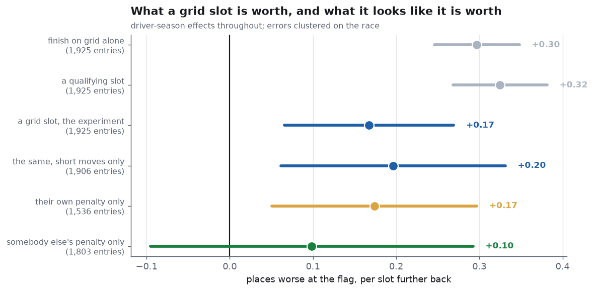
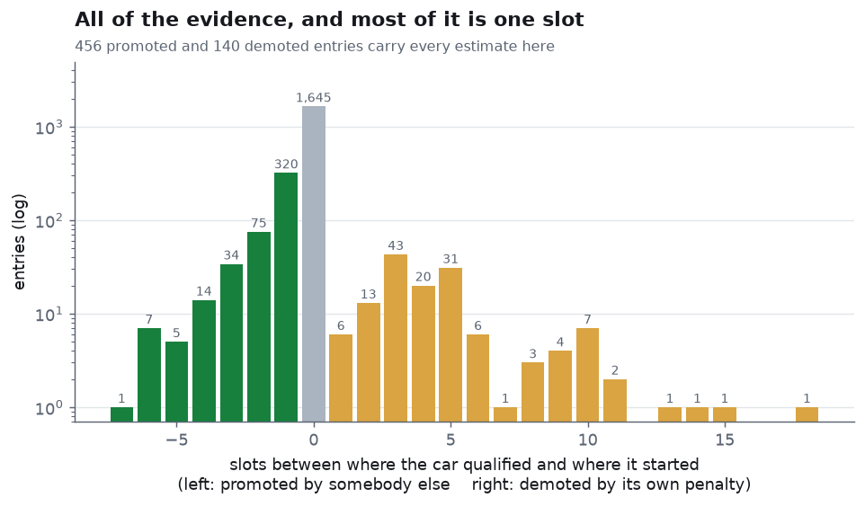
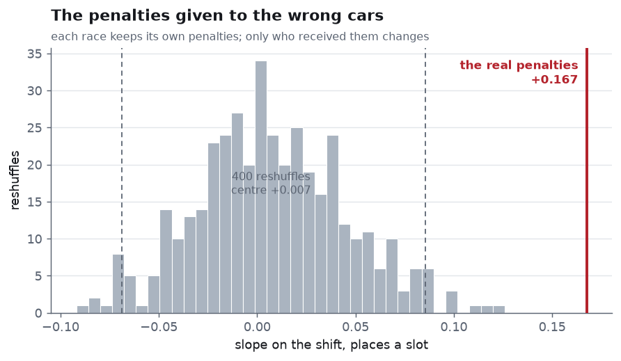
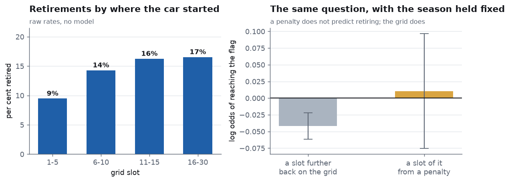
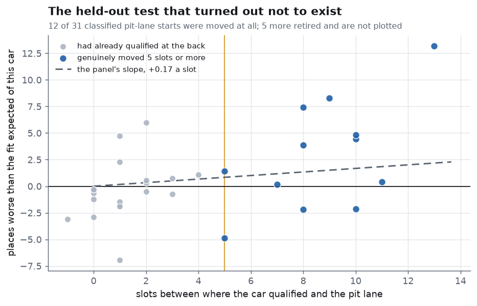
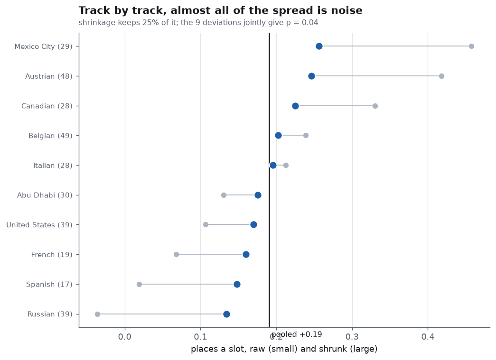

# grid-slot-value

**What one grid slot is actually worth, measured from the only thing in
Formula 1 that moves a car without changing the car.**

Where a car starts predicts where it finishes almost perfectly, and
almost none of that is the starting place. Quick cars start at the front
and finish at the front. Regress finishing position on grid position and
you have measured the car and called the answer track position.

A grid penalty does not change the car, the driver, the circuit or the
weather. It just moves the car. Over 2018-2023 that happened to **596 of
2,241 entries**, and every number here comes from them.

**A grid slot is worth 0.17 places at the flag**, 95% interval
[+0.07, +0.27]. Starting on grid alone says 0.30 — and that is already
inside a driver's own season, with the car held fixed. **Forty-four per
cent of what looks like track position is the car reasserting itself.**

---

## The experiment

Keep both numbers — where the car earned its slot on Saturday, and where
it actually started — and the difference between them is a shift the
car's own pace did not cause:

```
finish  =  a  +  b x qualified  +  c x shift  +  driver-season effects
```

`b` collects everything that being quick in qualifying implies about
being quick on Sunday. `c` is the slot on its own, because within a
driver's own season and at a given qualifying position, the only thing
moving `shift` is a steward's decision or somebody else's failed gearbox.

Since `grid = qualified + shift`, the same fit rewrites as
`finish = a + c x grid + (b - c) x qualified`, so `b - c` is the pace
premium: the part of a qualifying slot that is not track position at all.
It is **+0.157** places a slot, [+0.041, +0.274], p = 0.009. There is a
test that the two parameterisations give identical numbers, because they
are the same model written twice.



| what is being measured | entries | places a slot | 95% interval | excludes zero |
|---|---:|---:|---|---|
| finishing position on grid alone | 1,925 | +0.297 | +0.246 to +0.348 | yes |
| a qualifying slot | 1,925 | +0.325 | +0.268 to +0.381 | yes |
| **a grid slot, the experiment** | **1,925** | **+0.167** | **+0.066 to +0.269** | **yes** |
| the same, short moves only | 1,906 | +0.196 | +0.061 to +0.331 | yes |
| their own penalty only | 1,536 | +0.174 | +0.051 to +0.297 | yes |
| somebody else's penalty only | 1,803 | +0.099 | −0.095 to +0.292 | no |

Errors are clustered on the race throughout, because a penalty to one car
promotes every car behind it: the twenty rows of one Sunday are one event
seen twenty times.

---

## All of the evidence, and most of it is one slot



This is the honest limit of the design, and it is the thing most worth
knowing about it. A promotion is nearly always a single slot — 320 of the
456 of them — so the estimate fitted on promoted cars alone, the only
cars moved for a reason that has nothing to do with them, runs from
−0.095 to +0.292. It contains zero and it contains the pooled answer. It
refutes nothing and it confirms nothing.

Fitting both directions in **one** design is what makes the comparison
testable, because two separate fits share no covariance and their
difference has no interval. Backwards costs +0.183 a slot and forwards
pays −0.117. If the effect were symmetric those would sum to zero; they
sum to **+0.066 ± 0.119, p = 0.58**. So losing a slot and gaining one are
worth about the same, and the thin promoted-only number is not evidence
against the demoted one.

---

## Two ways to catch this inventing an effect

A small p value is not evidence that a design works. Both of these would
find something on data where there is nothing to find, if the method were
broken.



**Give each race's penalties to the wrong cars.** Every race keeps
exactly the penalties it really had — the sizes, the count, the weekend —
and only *who received them* is destroyed. **0 of 400 reshuffles reached
the real slope (p = 0.0025)**, and they centre on +0.007 with a standard
deviation of 0.038.

**Then predict a race that already happened.** A penalty handed out on
Saturday cannot change what the same driver did a fortnight earlier, so
the slope on the driver's *previous* finishing position has to be zero.
It is **−0.027**, [−0.122, +0.069], p = 0.58. Anything else would mean
penalties go to drivers whose results were already moving, and the
exogeneity this whole project rests on would not be there. There is a
test that plants exactly that violation and checks the placebo sees it.

---

## The exclusion that could bend it



316 of 2,241 entries never reached the flag, and a retirement has no
finishing position, so they are not in the main fit. Two different
worries live here and they have opposite answers.

| grid slot | entries | retired | share |
|---|---:|---:|---|
| 1-5 | 570 | 54 | 9.5% |
| 6-10 | 567 | 81 | 14.3% |
| 11-15 | 566 | 92 | 16.3% |
| 16-30 | 538 | 89 | 16.5% |

**A grid slot does predict retiring** — odds ratio 0.959 a slot,
p < 0.001 — so the cars that suffered most from a bad slot are partly
missing from the outcome, and 0.17 is an understatement rather than an
overstatement. **A penalty does not** — odds ratio 1.011, p = 0.81.
Demoted entries actually retired slightly *less* than the panel (12.9%
against 14.0%). The gearbox story, where a penalised car is a broken car
that was going to fail anyway, does not show up.

The logit carries season effects rather than driver-season effects
because many driver-seasons contain no retirement at all, which predicts
the outcome perfectly and leaves the likelihood with no finite maximum.
The code checks that claim instead of asserting it: it attempts the fit
and reports the refusal, which reads *"the weighted design has lost rank,
which is what separating looks like once the weights collapse."*

---

## The held-out test that turned out not to exist



Pit-lane starts are excluded from every fit, because the pit lane is not
a grid slot and the distance from ninth to it is not a number of places.
The plan was to use them as a held-out set: moved further than any
penalty in the panel, so a good test of whether a slope fitted on one to
ten slots says anything about being sent to the back.

**Almost none of them were moved.** Their median distance from where they
qualified is 2 slots, and only 12 of 31 classified starts were moved five
or more, because the failure that earns a pit-lane start is usually the
failure that ruined qualifying — these cars had already qualified at the
back. For a few the distance is *negative*: when several cars start from
the pit lane the grid is shorter than the qualifying order, so a car that
qualified last was going to start last either way.

Over the twelve that really moved the implied slope is +0.335 against the
panel's +0.167, which hints that a long move costs more per slot than a
short one. Their scatter is many times the effect. It settles nothing,
and the honest version of this section is the one that says so.

---

## Track by track



| circuit | entries | moved | slope | error | shrunk |
|---|---:|---:|---:|---:|---:|
| Mexico City | 87 | 29 | +0.457 | 0.113 | +0.256 |
| Austrian | 100 | 48 | +0.418 | 0.164 | +0.247 |
| Canadian | 69 | 28 | +0.330 | 0.187 | +0.225 |
| Belgian | 83 | 49 | +0.239 | 0.112 | +0.202 |
| Italian | 82 | 28 | +0.212 | 0.064 | +0.196 |
| Abu Dhabi | 107 | 30 | +0.131 | 0.078 | +0.176 |
| United States | 64 | 39 | +0.107 | 0.070 | +0.170 |
| French | 72 | 19 | +0.068 | 0.068 | +0.160 |
| Spanish | 107 | 17 | +0.019 | 0.275 | +0.148 |
| Russian | 69 | 39 | −0.036 | 0.167 | +0.134 |

Shrinkage keeps **25%** of the spread between circuits and attributes the
rest to sampling noise. Jointly the nine deviations give F = 2.29,
p = 0.035, so the circuits do differ. **The order they differ in is not
readable**, and it does not line up with where overtaking is hard:
Austria and Montreal sit high, Spa and Monza in the middle, Sochi at the
bottom. A quarter of a spread is not a ranking.

---

## Where the penalties happen is a choice

| circuit | entries | moved | share moved |
|---|---:|---:|---:|
| Las Vegas | 20 | 17 | 85% |
| Turkish | 38 | 25 | 66% |
| United States | 78 | 46 | 59% |
| Belgian | 95 | 55 | 58% |
| … | | | |
| Emilia Romagna | 39 | 0 | 0% |
| Miami | 38 | 0 | 0% |

A team changing a power unit decides *when*, and it picks a weekend where
starting further back is cheap. So the variation this entire project is
identified from is not spread over the calendar.

The weighting is not where this bites: pooled over the eligible circuits
the slope is +0.190 and the unweighted mean of their own slopes is
+0.195, near enough identical, so the busy circuits are not dragging the
pooled number about. **What bites is the 21 circuits that cannot be
fitted at all** — Monaco among them, where a slot should be worth more
than anywhere. They are missing rather than down-weighted, and nothing
here can say what a slot was worth at them.

Every number on this page answers "what was a slot worth where penalties
were actually taken", which is the right question for pricing a penalty
and a narrower one than pricing a grid slot.

---

## What it cost

116 demoted entries reached the flag inside the ten-slot support,
489 slots between them, for **146 championship points** — 1.26 an entry,
with only 56 of them losing anything at all, because most penalties land
outside the points. Six entries were moved further than ten slots and are
refused rather than extrapolated.

The worst single one: Leclerc at Austin in 2022, moved ten slots,
finished third where the slope says first — ten points.

This is what the penalised cars gave up, **not** what the grid
rearranged. Un-penalising one car moves every car it passes, and those
counterfactuals are not computed, so the gains on the other side of these
losses are missing. They are not the same quantity and summing them would
be wrong.

---

## What this does not do

- **It cannot say why a car was moved.** The feed records the grid and
  the qualifying order, not the reason. Gearbox, power unit, impeding,
  blocking and a technical infringement are one undifferentiated column.
- **It is local and linear.** The slope is an average over moves of one
  to ten slots. It does not extrapolate to being sent to the back, and
  the one attempt to check that found no data to check it with.
- **Sprint weekends are dropped entirely** — 220 entries. From 2021 the
  sprint sets the grid, so the gap between qualifying and the start is a
  race result there, and keeping it would put a race on the right-hand
  side of the fit.
- **It measures places, not positions gained on track.** A car that loses
  0.17 places per slot may be losing them at the start, in traffic, or to
  a strategy forced on it by where it started. Nothing here separates
  those.
- **Six seasons.** 140 demoted entries is why the interval on the main
  number is a third of its own width.

---

## What I got wrong

**The per-circuit fit reported a slope with no interpretation.** It kept
every row, so the bare `shift` term meant "the baseline circuit, and also
the twenty-one circuits with too little penalty variation to earn a
column of their own" — a quantity that is not any circuit's slope and not
a pooled one either. It was then printed as "pooled" and used as the
centre to shrink every circuit towards. The fit is now restricted to the
eligible circuits, and the pooled slope is the plain one from the same
rows, so the estimates and the thing they are compared with come from the
same data. The reported pooled slope moved from +0.274 to +0.190.

**A counterfactual that claimed a car would have won.** Pricing the
penalties in points multiplied the slope by however far each car was
moved, including an eighteen-slot penalty — which announced that Bottas
would have won Abu Dhabi in 2019 instead of finishing fourth. That is
exactly the extrapolation the rest of the project refuses. The cost is
now computed only inside the ten-slot support, with the six entries
beyond it refused and counted, and the total fell from 185 points to 146.

**The fixture broke the identity one of its own tests was checking.** The
synthetic season clamped the grid to at least 1 while leaving the shift
at the value it had drawn, so a row could claim a three-slot penalty it
had not received, and `grid = qualified + shift` quietly stopped holding.
The test that checks the two parameterisations agree failed, which is the
test doing its job on the wrong target. The fixture now clamps the shift
and derives the grid.

**And a narration line that was true when written.** The run printed
"the apparent slope and the honest one are close here, which is itself
the finding" — correct on the first three seasons, and flatly wrong once
all six were in, where they are 0.30 and 0.17. It is now computed from
the fit rather than typed.

---

## Running it

```bash
pip install -r requirements.txt
python run.py
```

Six seasons are cached in `data/`, so it runs offline and a second run
costs nothing. Output goes to `out/`: six PNGs and a printable
`report.pdf`.

```bash
python -m pytest tests -q
```

36 tests, in three kinds and no fourth. Algebra with one right answer:
the two parameterisations of the same fit must agree because
`grid = qualified + shift`; demeaning within a group must give the same
slope as a column of dummies, because Frisch-Waugh-Lovell says so;
shrinkage with no sampling error must change nothing. Recovery of a
planted truth: a synthetic season with a known slot effect, and — where a
diagnostic exists to catch a problem — the problem planted, so the
diagnostic has to react, and absent, so it has to stay quiet. And
refusals: every measurement the code declines is checked to be declined.
No test compares against saved output.

---

## Layout

| file | what is in it |
|---|---|
| `src/data.py` | fetch and cache qualifying, grid and results |
| `src/panel.py` | the analysis panel, its exclusions, and the points table |
| `src/linear.py` | least squares and logit, both cluster-robust |
| `src/slot.py` | what a slot is worth, by direction and by circuit |
| `src/placebo.py` | the reshuffle and the backwards prediction |
| `src/confound.py` | retirements, and the cost in points |
| `src/charts.py` | the six figures |
| `src/report.py` | the printable PDF report |
| `src/paper.py` | page composition: A4 pages, tables, figure bands |
| `run.py` | the pipeline, start to finish |

---

## Fachbegriffe

| English | Deutsch |
|---|---|
| grid slot | Startplatz |
| starting grid | Startaufstellung |
| grid penalty | Startplatzstrafe |
| qualifying | Qualifikation |
| pit lane start | Start aus der Boxengasse |
| sprint race | Sprintrennen |
| retirement | Ausfall |
| classified finisher | gewerteter Finisher |
| natural experiment | natürliches Experiment |
| identification | Identifikation |
| exogeneity | Exogenität |
| confounder | Störgröße |
| fixed effects | feste Effekte |
| cluster-robust standard error | clusterrobuster Standardfehler |
| placebo test | Placebo-Test |
| permutation test | Permutationstest |
| selection effect | Selektionseffekt |
| shrinkage estimator | Schrumpfungsschätzer |
| counterfactual | kontrafaktischer Vergleich |
| confidence interval | Konfidenzintervall |
| extrapolation | Extrapolation |
| support (of an estimate) | Stützbereich |

---

## Data

Qualifying, grid and race results from the
[Jolpica](https://api.jolpi.ca) mirror of the Ergast schema, 2018-2023:
2,500 race entries over 125 races, of which 114 survive into the panel.
This project needs no lap times, so
the fetch is two requests a race. The cleaning conventions are carried
over from
[stint-degradation](https://github.com/Pratsss24/stint-degradation),
[undercut-effect](https://github.com/Pratsss24/undercut-effect),
[pace-to-pass](https://github.com/Pratsss24/pace-to-pass),
driver-or-car and safety-car-lottery.
